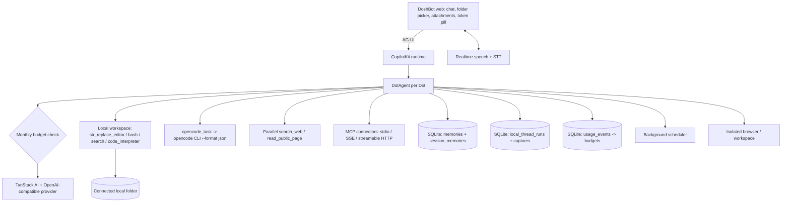

<div align="center">

# DoshBot

### Always-on AI coding coworker — chat, code, schedule, research.

**DoshBot by SafarNow. Self-hosted. Connect a local folder and get real work done 24/7.**

Built with CopilotKit, AG-UI, TanStack AI, OpenCode engine + Open Interpreter parity. · [Get started](#get-started) · [Features](#features) · [Architecture](#architecture) · [Memory & tokens](#memory--tokens--context-cache) · [Contributing](CONTRIBUTING.md)

[](https://github.com/asish231/DoshBot/actions/workflows/ci.yml)
[](./LICENSE)

Fully self-hostable. Clone, connect your model, point it at a folder, and code.

</div>

---

## What is DoshBot?

DoshBot is a persistent agent workspace. Each Dot is a specialist with its own conversation, memory, computer, and local coding workspace.

Current highlights:

- **In-chat local directory picker (Claude / DSH style)** — composer pill + `+` menu → Verify & Connect. Agent runs `str_replace_editor`, `bash`, `code_interpreter`, `opencode_task` inside that folder.
- **Coding engine in chat** — `str_replace_editor` (view/create/str_replace/insert/undo_edit), `bash` with exit codes, `search_files`, `code_interpreter` (python/js/ts), `opencode_task` (native `opencode run --format json` delegation with free-tier models).
- **MCP connectors execute for real** — enabled stdio/SSE/streamable-HTTP servers connect at the start of each turn and their tools appear live to every Dot (max 5 servers, 20 tools each, 8s connect timeout).
- **Dot budgets with hard stops** — per-Dot monthly estimated-token budget; an over-budget Dot refuses new turns until the owner raises the budget or resets usage. Usage readout and reset live in the Dot dialog.
- **File + image attachments** — `+` button uploads code/docs (inline) and images (vision markdown), up to 6 files / 8MB each.
- **Per-session in/out tokens** — header pill shows `↑in ↓out (%)`, tooltip with total/max/msgs, persisted per thread, click to compact.
- **Dual-layer memory** — global `memories` + per-thread `session_memories`, categorized (`preference/fact/instruction/project/goal/note/todo`), `/memory [session|global] [category]`.
- **Context cache controls** — `/compact` summarizes runs into a checkpoint, `/clear` wipes messages without deleting the session.
- **Ask questions** — `ask_question` human-in-the-loop cards (2–6 options, single/multi).
- **Research** — `search_web` + `read_public_page` via Parallel, citations saved.
- **24/7 scheduling** — server-side recurring tasks in their original conversation, pause/retry.
- **Spaces + Pages** — searchable library, visual editor, save conversation as page, review-before-save.
- **Voice + calls, computer browser, Slack/Telegram** — realtime speech, isolated browser/workspace, channel SDKs.

Slash commands: `/goal /code /plan /compact /memory /mcp /subagents /schedule /search /browse /clear /help`.

## Get started

Use **Node.js 24** and **npm**:

```sh
git clone https://github.com/asish231/DoshBot.git
cd DoshBot
npm ci
cp .env.example .env
npm run dev
```

Open **http://127.0.0.1:5173**. Set your model in Settings, connect a local folder from the chat pill, then try:

```
/code Audit this workspace and propose a safe first edit
```

See [Setup](docs/SETUP.md) for models, Parallel search, browser service, voice, Slack, and Docker.

## Features

| Area            | Included in DoshBot                                                                                                                                           |
| --------------- | ------------------------------------------------------------------------------------------------------------------------------------------------------------- |
| Chat coding     | Local folder picker in composer, `str_replace_editor`, `bash`, `search_files`, `code_interpreter`, `opencode_task` native delegation, folder path containment |
| Attachments     | `+` menu for files + images, inline preview chips, vision-ready markdown                                                                                      |
| Tokens          | Per-session `↑in ↓out (%)`, model context windows (Gemini 2M, Claude/Kimi 200k, DeepSeek/GPT 128k), click-to-compact                                          |
| Memory          | Global + per-session SQLite tables, categories, `/memory`, session isolation + cascade delete                                                                 |
| Context cache   | `local_thread_runs` persistence, `/compact` checkpoint, `/clear` reset, research `captures`                                                                   |
| Execution modes | `/goal` autonomous, `/code` repo work, `/plan` milestones, `/search` + `/browse` research                                                                     |
| Human-in-loop   | `ask_question` cards, page review Approve & save, `ask` coding permission blocks writes until the owner flips to auto                                         |
| Scheduling      | Recurring server tasks, pause/resume, run history, receipts in-thread                                                                                         |
| Budgets         | Per-Dot monthly token budget with hard stop, usage readout, owner reset (`usage_events` table)                                                                |
| MCP connectors  | Real stdio/SSE/streamable-HTTP execution per turn, tool passthrough with timeouts, credential redaction                                                       |
| Spaces/Pages    | Library, visual editor, slash commands, autosave, revision checks                                                                                             |
| Voice/Calls     | WebRTC speech, STT models, live call view, transcripts; hero voice-call button starts a real call                                                             |
| Computer        | Isolated browser/files/shell via OpenBot supervisor, takeover, permissions; pinned single sandbox image                                                       |
| Channels        | Slack managed connection + Telegram bot channel, allowlists                                                                                                   |
| Models          | Auto routers, DeepSeek, Kimi, Qwen, Gemini, Claude, GPT, OpenCode free-tier (`opencode/*-free`, `big-pickle`), effort levels `low/medium/high/xhigh/max`      |
| Security        | Owner-token auth on all APIs + Gemini-Live WS, credential redaction in API responses, CSP on API responses, SSRF-hardened read-only browser                   |

## Architecture



Key files:

- `src/server/dot-agent.ts` — builds prompt + all server tools per turn, budget hard stop, usage recording
- `src/server/coding-tools.ts` — editor/bash/search/interpreter/session+global memory, path containment, `ask` enforcement
- `src/server/mcp-connectors.ts` — real MCP connector runtime (stdio/SSE/streamable HTTP)
- `src/server/settings-redaction.ts` — credential redaction for API responses
- `src/server/opencode.ts` — binary discovery, free-model listing, `runOpenCode()`
- `src/server/store.ts` — global `memories`, tasks/schedules
- `src/server/workspace.ts` — spaces/dots/threads/runs/session memories/compact/clear/budgets/usage
- `src/server/workspace-routes.ts` — `/models`, `/opencode/*`, `/workspace/directory`, `/conversations/*`, `/dots/:id/usage`
- `src/client/Chat.tsx` — composer, `+` attachments, folder popover, `↑↓` token pill, STT error surfacing
- `src/client/token-counter.ts` — `chars/3.8` estimate, directional in/out, per-thread persistence
- `src/client/App.tsx` — hero, folder-connect card, thread list, hero voice-call autostart
- `src/client/ErrorBoundary.tsx` — SPA render-crash recovery card
- `src/client/SlashCommandsMenu.tsx` — command palette

## Memory / tokens / context cache

- **Global memory** (`store.memories()`): `memories(id,text,category,createdAt)`, all threads.
- **Session memory** (`workspace.sessionMemories(threadId)`): `session_memories(threadId,...)`, isolated, cleared on thread delete.
- **Runs cache** (`local_thread_runs`): full message snapshots via `PersistentLocalRunner`, restored on boot.
- **Compaction**: `compactThreadMessages()` keeps last 8 turns summarized; `clearThreadMessages()` resets.
- **Tokens**: `estimateMessageTokens = chars/3.8 + 20/msg`, `calculateTokenUsage()` adds 2500-char system overhead, maps model → max (2M/1M/200k/128k), `normal <65% < warning <85% < critical`. Directional split: user→in, assistant+tools→out.

## Development

```sh
npm run dev        # app + vite
npm run typecheck  # tsc --noEmit
npm test           # vitest run
npm run lint
npm run build
npm start
```

Tests cover dual-layer memory isolation, editor/undo/bash/search, permission deny + ask enforcement, path containment, token windows, compact/clear, MCP connector runtime, Dot budgets (storage + agent hard stop), credential redaction, ask_question schema, OpenCode status.

## Contributing

See [Contributing](CONTRIBUTING.md). Keep credentials, `data/*.sqlite`, and local paths out of commits. Describe workflow + verification evidence.

## License

[MIT](LICENSE). Copyright (c) DoshBot by SafarNow.

Built and maintained by Asish Kumar Sharma (SafarNow).

## Public-web research disclosure

`search_web` sends objective + 1–3 queries + thread session id to `https://search.parallel.ai/mcp`. Full conversations and memories are not auto-forwarded. Set `PARALLEL_API_KEY` for production. `WEB_SEARCH_PROVIDER=browser|disabled` switches to URL-only reader or disables research.

## MCP connector disclosure

Enabled `local_stdio` connectors launch the command you configured as a local subprocess; `remote_sse` / `remote_mcp` connectors call the endpoint you configured with your token. Connector tools run with the same owner privileges as the Dot. Configure only servers you trust.
